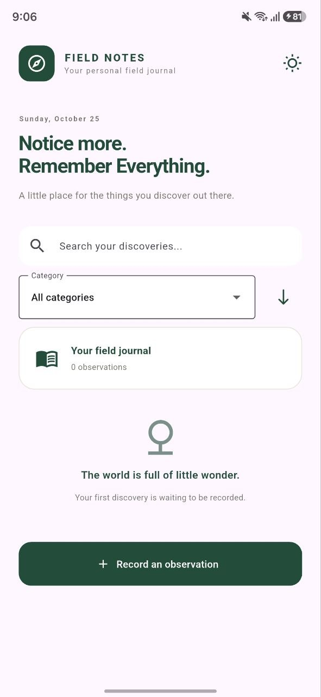
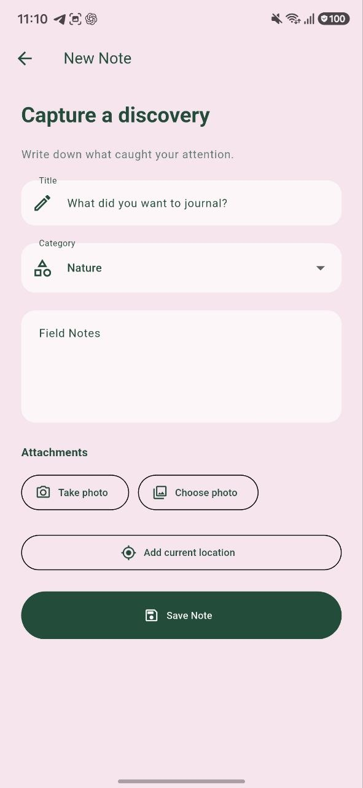
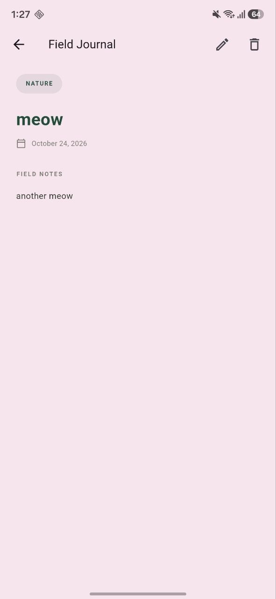
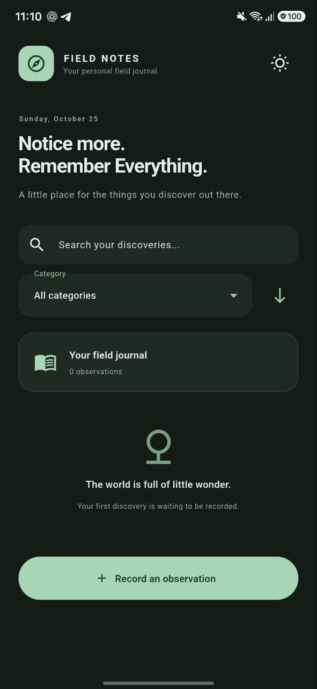

# Field Notes

**Your personal field journal.**

Field Notes is an offline-first journaling app built with Flutter. Capture interesting discoveries, document observations with photos, and save locations so you can revisit the places that mattered.

## Features

- **Journal entries** — Create, edit, and delete notes.
- **Photo attachments** — Capture photos with your camera or choose them from your gallery.
- **Location tagging** — Save the coordinates of a discovery and open them in Maps.
- **Categories** — Organize observations by Nature, Plants, Wildlife, Places, Landmarks, and Other.
- **Search and sorting** — Find entries and browse them by date.
- **Light and dark themes** — Choose the appearance that suits you.
- **Offline storage** — Keep your notes on your device without requiring an account.

## Screenshots

<!-- Add your screenshots to a screenshots/ directory and update these paths. -->

| Home | New Note |
|---|---|
|  |  |

| Note Details | Dark Mode |
|---|---|
|  |  |

## Built With

- Flutter and Dart
- SQLite with `sqflite`
- `image_picker` for photo attachments
- `geolocator` for location capture
- `shared_preferences` for saving theme preferences
- `url_launcher` for opening map locations

## Getting Started

### Requirements

- Flutter SDK
- Android development environment or an Android device

### Run from source

Clone the repository:

```bash
git clone https://github.com/YOUR-USERNAME/field_notes.git
cd field_notes
```

Install dependencies:

```bash
flutter pub get
```

Run the app:

```bash
flutter run
```

## Download

Prebuilt Android APKs will be available on the project's GitHub Releases page when published.

1. Open the repository's **Releases** section.
2. Download the APK attached to the release.
3. Install it on a compatible Android device.

Alternatively, build the APK yourself:

```bash
flutter build apk --release
```

The resulting APK is located at:

```text
build/app/outputs/flutter-apk/app-release.apk
```

## Data Storage

Notes are stored locally in a SQLite database. Photo attachments are kept in the app's private storage, and the selected theme preference is saved on the device.

The current version does not include cloud synchronization. Your entries are not automatically transferred between devices.
